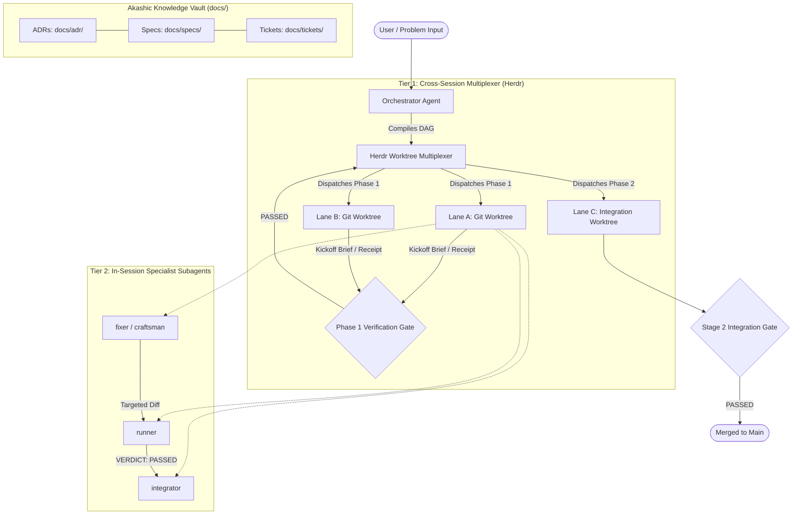
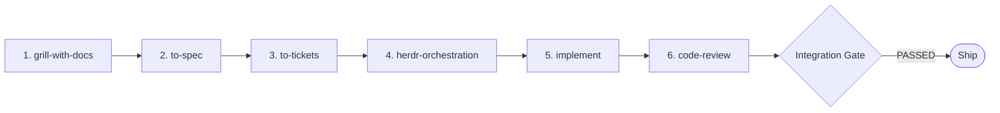

# pedroca-skills

> **The Agentic Engineering Skills Framework for Autonomous Coding, Multi-Lane Herdr Worktrees, and Akashic Knowledge Graphs.**

`pedroca-skills` is a production-grade, battle-tested system of 73 composable agent skills designed for autonomous AI software engineering. It enforces rigorous software craft: deterministic verification gates, typed knowledge graphs (Open Knowledge Format v0.2), multi-lane parallel worktree dispatch, test-driven development (TDD), and disciplined subagent role boundaries.

---

## Table of Contents

- [Core Architecture & Execution Topology](#core-architecture--execution-topology)
  - [Tier 1: Cross-Session Worktree Multiplexer (Herdr Lanes)](#tier-1-cross-session-worktree-multiplexer-herdr-lanes)
  - [Tier 2: In-Session Specialist Subagents](#tier-2-in-session-specialist-subagents)
  - [Model Tier Allocation & Escalation Protocol](#model-tier-allocation--escalation-protocol)
- [Canonical Spine: Idea to Ship](#canonical-spine-idea-to-ship)
- [Akashic OKF v0.2 Knowledge Vault](#akashic-okf-v02-knowledge-vault)
- [Layer Catalog](#layer-catalog)
  - [1. Spine (Core Lifecycle)](#1-spine-core-lifecycle)
  - [2. On-Ramps (Entry Points)](#2-on-ramps-entry-points)
  - [3. Upkeep (Codebase Health)](#3-upkeep-codebase-health)
  - [4. Foundations (Architecture & Governance)](#4-foundations-architecture--governance)
  - [5. Engineering (Deep Craft & Operations)](#5-engineering-deep-craft--operations)
  - [6. Android (Mobile & Embedded Systems)](#6-android-mobile--embedded-systems)
  - [7. Design (Frontend, Systems & Visual QA)](#7-design-frontend-systems--visual-qa)
  - [8. Utilities (Parsing & Analysis Helpers)](#8-utilities-parsing--analysis-helpers)
- [Installation & Quickstart](#installation--quickstart)
  - [1. Navigate with ask-pedroca](#1-navigate-with-ask-pedroca)
  - [2. Onboard a Repository](#2-onboard-a-repository)
  - [3. Harness Integration](#3-harness-integration)
- [Verification Gates & Test Suite](#verification-gates--test-suite)
- [Standards & Conventions](#standards--conventions)

---

## Core Architecture & Execution Topology

`pedroca-skills` operates on a deterministic **Two-Tier Topology** separating macro workflow orchestration from micro task execution.



### Tier 1: Cross-Session Worktree Multiplexer (Herdr Lanes)
- **Isolated Worktrees**: Every major workstream runs inside its own Git worktree on an independent branch (`lane/<topic>-<lane>`).
- **Structured Artifact Handoffs**: Worktrees do not share uncommitted filesystem state. The Orchestrator issues an immutable **Kickoff Brief** (`/tmp/handoff-<session>-<lane>.md`), and each lane responds with a signed **Completion Receipt** (`/tmp/handoff-<session>-<lane>-result.md`).
- **Phase Gates**: Dependencies between tickets are resolved by `to-tickets/scripts/compile_dag.py` into topological phases. Phase $N+1$ worktrees only launch once all Phase $N$ lanes declare `VERDICT: PASSED`.

### Tier 2: In-Session Specialist Subagents
Within any given workspace, the active session acts as an orchestrator and **does not edit code directly**. All mutations are delegated to role-bounded specialist subagents:

| Specialist Subagent | Lane Role | Default Model Tier | Primary Responsibilities |
|---|---|---|---|
| `fixer` | Bounded Implementation | Balanced Workhorse Tier | Produces minimal targeted code diffs, bugfixes, and TDD slice implementations. |
| `craftsman` | Advanced Implementation | Advanced Implementation Tier | Complex refactors, state machine redesigns, architectural decoupling. |
| `runner` | Verification Gate | Routine Execution Tier | Read-only deterministic test execution, build validation. Returns `VERDICT: PASSED\|FAILED\|BLOCKED`. |
| `integrator` | Git Delivery Gate | Balanced Workhorse Tier | Scoped Git status checks, staging, clean commit crafting, and branch delivery. |
| `librarian` | Research & Docs | Routine Execution Tier | Fast Context7 MCP / documentation lookups. |
| `evaluator` | Escalation Gatekeeper | Advanced Routing & Triage Tier | Read-only diagnostic triage after two failed implementation attempts. |
| `oracle` | Architecture & RCA | Frontier Reasoning Tier | Deep root cause analysis, complex system modeling, frontier reasoning via Akashic MCP. |
| `council` | Multi-Model Consensus | Frontier Reasoning Tier | Synthesizes opposing viewpoints on high-risk architectural trade-offs. |

### Model Tier Allocation & Escalation Protocol
- **Tier 1 (Routine Execution)**: Routine Execution Tier (`runner`, `librarian`) handles fast, lightweight checks.
- **Tier 2 (Balanced Workhorse & Advanced Implementation)**: Balanced Workhorse Tier (`fixer`, `integrator`) and Advanced Implementation Tier (`craftsman`, `evaluator`) handle code mutations, triage, and complex refactors.
- **Tier 3 (Exceptional Frontier Reasoning)**: Frontier Reasoning Tier (`oracle`, `council`) is reserved strictly for complex architectural deadlocks.
- **10-Step Automatic Escalation Protocol**: Direct fixes are strictly capped at two attempts. If two consecutive `runner` checks fail, control automatically transfers to `evaluator` for root cause triage before invoking `oracle` or `craftsman`.

---

## Canonical Spine: Idea to Ship

The backbone of `pedroca-skills` is a 6-stage delivery pipeline turning ambiguity into verified production code:



1. **`grill-with-docs`**: A relentless Socratic interview that stress-tests requirements, captures domain terms in `CONTEXT.md`, and scaffolds foundational Architecture Decision Records (ADRs) under `docs/adr/`.
2. **`to-spec`**: Synthesizes the interview and decisions into an Open Knowledge Format v0.2 Specification document under `docs/specs/<topic>.md`.
3. **`to-tickets`**: Decomposes the specification into vertical, tracer-bullet OKF v0.2 Ticket nodes under `docs/tickets/<topic>/` with forward-only blocking relations (`depends_on`). Compiles dependencies into a topological execution DAG via `compile_dag.py`.
4. **`herdr-orchestration`**: Reads the compiled DAG and dispatches parallel execution lanes across isolated Git worktrees under Herdr multiplexer workspaces.
5. **`implement`**: Executes bounded tickets using strict Red-Green-Refactor TDD slices, specialist subagents (`fixer`, `runner`), and Stage 1 verification gates.
6. **`code-review`**: Conducts a parallel tri-axis evaluation across **Standards** (lint/style), **Spec Conformance** (acceptance criteria verification), and **Complexity** (algorithmic time/space analysis).

---

## Akashic OKF v0.2 Knowledge Vault

Every repository managed with `pedroca-skills` stores architectural state directly in the codebase using the **Open Knowledge Format (OKF v0.2)**, validated deterministically by `akashic lint`:

```toml
# config/akashic.toml
[vault]
path = "docs"
db_path = ".akashic/vault_index.db"
okf_version = "0.2"

[lint]
enabled_rules = ["L001", "L002", "L003", "L004", "L005", "L006", "L007", "L008", "L009", "L010", "L011", "L012"]
strict_forward_only = true

[lint.custom_fields.artifact]
required = false
type = "string"
allowed_values = ["adr", "spec", "ticket"]
applies_to = ["decision", "architecture", "guide"]
```

### Knowledge Vault Structure
```
docs/
├── adr/                      # Architectural Decision Records (artifact: adr)
│   └── 0001-<slug>.md
├── specs/                    # Feature Specifications (artifact: spec)
│   └── <topic>.md
└── tickets/                  # Tracer-Bullet Work Items (artifact: ticket)
    └── <topic>/
        ├── 01-<task>.md
        └── 02-<task>.md
```

### Typed Graph Edges
- `depends_on`: Declares prerequisite execution dependencies between tickets (e.g., ticket 02 cannot start until ticket 01 passes).
- `supported_by`: Links tickets back to their parent specification (`docs/specs/<topic>.md`).
- `supersedes`: Explicit lineage tracking between ADRs.

Deterministic verification:
```bash
akashic lint --strict --vault docs
```

---

## Layer Catalog

All 73 skills are organized into 8 functional layers under `skills/`:

### 1. Spine (Core Lifecycle)
*Canonical end-to-end delivery workflow from interview to review.*

| Skill | Path | Description |
|---|---|---|
| `grill-with-docs` | `skills/spine/grill-with-docs` | Socratic interview to sharpen plans, capturing domain terms in `CONTEXT.md` and bootstrapping ADRs. |
| `to-spec` | `skills/spine/to-spec` | Synthesizes current conversation into a comprehensive OKF v0.2 specification document in `docs/specs/`. |
| `to-tickets` | `skills/spine/to-tickets` | Decomposes specifications into tracer-bullet tickets with explicit dependencies and compiles topological DAGs. |
| `herdr-orchestration` | `skills/spine/herdr-orchestration` | Coordinates multi-lane parallel implementation across isolated Git worktrees in Herdr multiplexer workspaces. |
| `implement` | `skills/spine/implement` | Implements bounded engineering work for a single scope using TDD slices, specialist subagents, and verification gates. |
| `code-review` | `skills/spine/code-review` | Evaluates pull requests and branches along three parallel axes: Coding Standards, Spec Conformance, and Complexity. |

### 2. On-Ramps (Entry Points)
*High-velocity entry points for unstructured incoming work, bug reports, and large-scale initiatives.*

| Skill | Path | Description |
|---|---|---|
| `triage` | `skills/on-ramps/triage` | Categorizes incoming issues and external PRs, reproduces defects, and drafts agent-ready execution briefs. |
| `diagnosing-bugs` | `skills/on-ramps/diagnosing-bugs` | Systematic diagnosis loop for hard-to-reproduce bugs, concurrency anomalies, and performance regressions. |
| `wayfinder` | `skills/on-ramps/wayfinder` | Breaks down massive multi-session initiatives into a shared map of decision tickets and frontiers. |

### 3. Upkeep (Codebase Health)
*Continuous architecture hygiene, module deepening, and debt elimination.*

| Skill | Path | Description |
|---|---|---|
| `improve-codebase-architecture` | `skills/upkeep/improve-codebase-architecture` | Analyzes codebases for deepening opportunities using Akashic Code Graph tools and generates visual HTML reports. |

### 4. Foundations (Architecture & Governance)
*Core mental models, repository bootstrapping, and code knowledge graph querying.*

| Skill | Path | Description |
|---|---|---|
| `ask-pedroca` | `skills/foundations/ask-pedroca` | Ecosystem workflow router guiding agents and users to the right skill or lifecycle flow. |
| `setup-pedroca-skills` | `skills/foundations/setup-pedroca-skills` | Bootstraps a repository with `config/akashic.toml`, `docs/` vault structure, OKF frontmatter helpers, and verification rules. |
| `domain-modeling` | `skills/foundations/domain-modeling` | Establishes domain terminology, ubiquitous language in `CONTEXT.md`, and ADRs for bounded contexts. |
| `codebase-design` | `skills/foundations/codebase-design` | Deep module design principles: interface design, abstraction seams, and testable boundaries. |
| `akashic-cli` | `skills/foundations/akashic-cli` | Manages and queries Akashic code knowledge graphs, runs strict vault lints, and executes root cause analysis. |

### 5. Engineering (Deep Craft & Operations)
*Developer tooling, TDD, Git operations, multiplexer control, and prompt engineering.*

| Skill | Path | Description |
|---|---|---|
| `tdd` | `skills/engineering/tdd` | Enforces disciplined Red-Green-Refactor test-driven development before writing application logic. |
| `verification-planning` | `skills/engineering/verification-planning` | Constructs robust, project-specific verification matrices and evidence paths before coding. |
| `simplify` | `skills/engineering/simplify` | Simplifies code structure and eliminates cognitive clutter while strictly preserving observable behavior. |
| `prototype` | `skills/engineering/prototype` | Builds throwaway prototypes to sanity-check complex state models, APIs, and UI ergonomics. |
| `research` | `skills/engineering/research` | Conducts deep investigations against high-trust primary sources, archiving findings in Markdown. |
| `clonedeps` | `skills/engineering/clonedeps` | Clones external dependency repositories into an isolated local workspace for direct source inspection. |
| `babysit-pr` | `skills/engineering/babysit-pr` | Monitors CI runs, diagnoses test failures, routes automated fixes, and auto-merges on green. |
| `resolving-merge-conflicts` | `skills/engineering/resolving-merge-conflicts` | Resolves complex Git merge, rebase, and cherry-pick conflicts safely without regressions. |
| `setup-pre-commit` | `skills/engineering/setup-pre-commit` | Configures Husky pre-commit hooks, lint-staged, code formatters, and fast test gates. |
| `handoff` | `skills/engineering/handoff` | Serializes in-flight conversational and technical context into portable Markdown handoff files. |
| `herdr` | `skills/engineering/herdr` | Controls Herdr terminal multiplexer workspaces, panes, commands, and multi-agent coordination. |
| `wizard` | `skills/engineering/wizard` | Generates interactive bash wizards that guide humans through privileged credentials or cloud operations. |
| `teach` | `skills/engineering/teach` | Explains complex engineering mechanisms, invariants, and algorithms with clarity. |
| `to-questionnaire` | `skills/engineering/to-questionnaire` | Transforms complex ambiguous requirements into structured multi-choice qualification questionnaires. |
| `grill-me` | `skills/engineering/grill-me` | Interactive interrogation to uncover hidden assumptions and clarify edge cases in technical proposals. |
| `grilling` | `skills/engineering/grilling` | Relentless adversarial challenge skill to stress-test designs and architectural trade-offs. |
| `wait-what` | `skills/engineering/wait-what` | Pauses execution when encountering suspicious patterns, asking clarifying sanity checks. |
| `writing-for-agents` | `skills/engineering/writing-for-agents` | Authoring guidelines for high-precision, unambiguous prompt contracts and agent specifications. |
| `reflect` | `skills/engineering/reflect` | Analyzes recent workflows, extracts recurring patterns, and suggests reusable agent skills. |
| `retro` | `skills/engineering/retro` | Conducts a retrospective on a coding session, suggesting environment, guardrail, and steering improvements. |
| `pr` | `skills/engineering/pr` | Environment-agnostic review submission and evidence formatting for Gerrit, GitHub PRs, and GitLab MRs. |

### 6. Android (Mobile & Embedded Systems)
*Production Android, Kotlin Multiplatform, Jetpack Compose, and system-level engineering.*

| Skill | Path | Description |
|---|---|---|
| `adaptive` | `skills/android/adaptive` | Builds responsive Jetpack Compose UIs adapting to phones, foldables, tablets, desktops, and XR. |
| `agp-9-upgrade` | `skills/android/agp-9-upgrade` | Migrates Android applications to Android Gradle Plugin 9.0 and built-in Kotlin compilation. |
| `android-cli` | `skills/android/android-cli` | Controls the official Android CLI tool for headless previews, device interaction, and builds. |
| `android-command-routing` | `skills/android/android-command-routing` | Intelligent routing between ADB, Android CLI, Gradle daemon, and emulator execution. |
| `android-intent-security` | `skills/android/android-intent-security` | Audits and remediates Intent Redirection, exported components, and IPC security vulnerabilities. |
| `android-profiler` | `skills/android/android-profiler` | Captures and analyzes Perfetto traces for UI jank, thread scheduling, IPC storms, and memory leaks. |
| `appfunctions` | `skills/android/appfunctions` | Exposes application capabilities to AI agents and system shortcuts via `androidx.appfunctions`. |
| `camerax` | `skills/android/camerax` | Implements camera captures, concurrent video recording, and ML Kit integrations using CameraX. |
| `display-glasses-with-jetpack-compose-glimmer` | `skills/android/display-glasses-with-jetpack-compose-glimmer` | Builds Android XR projected experiences for display glasses using Jetpack Compose Glimmer. |
| `edge-to-edge` | `skills/android/edge-to-edge` | Implements immersive edge-to-edge layouts, window insets, and system bar contrast handling. |
| `engage-sdk-integration` | `skills/android/engage-sdk-integration` | Integrates Google Play Engage SDK to publish personalized recommendations and clusters. |
| `leanback-to-compose-tv-migration` | `skills/android/leanback-to-compose-tv-migration` | Migrates Android TV applications from legacy Leanback fragments to Jetpack Compose for TV. |
| `media3-cast-integration` | `skills/android/media3-cast-integration` | Integrates Google Cast playback into Jetpack Media3 CastPlayer pipelines. |
| `migrate-xml-views-to-jetpack-compose` | `skills/android/migrate-xml-views-to-jetpack-compose` | Step-by-step conversion of legacy XML View layouts into idiomatic Jetpack Compose composables. |
| `navigation-3` | `skills/android/navigation-3` | Implements Jetpack Navigation 3 scenes, multi-stack state saving, and deep linking architectures. |
| `play-billing-library-version-upgrade` | `skills/android/play-billing-library-version-upgrade` | Upgrades legacy Google Play Billing integrations to the latest stable PBL specifications. |
| `play-policy-insights` | `skills/android/play-policy-insights` | Cross-references static code analysis against Google Play Policy compliance requirements. |
| `r8-analyzer` | `skills/android/r8-analyzer` | Audits ProGuard and R8 rules, strips redundant package-wide keeps, and minimizes APK size. |
| `restore-credentials` | `skills/android/restore-credentials` | Implements Android Restore Credentials API for silent user re-authentication across device setup. |
| `styles` | `skills/android/styles` | Configures and standardizes Jetpack Compose Styles API across custom design system components. |
| `testing-setup` | `skills/android/testing-setup` | Establishes testing infrastructure across unit tests, Roborazzi screenshot tests, and UI tests. |
| `verified-email` | `skills/android/verified-email` | Implements cryptographic zero-friction email retrieval via Credential Manager. |
| `wear-compose-m3` | `skills/android/wear-compose-m3` | Designs and migrates Wear OS watch apps to Wear Compose Material 3. |

### 7. Design (Frontend, Systems & Visual QA)
*Frontend craftsmanship, design tokens, visual testing, and executive presentation engineering.*

| Skill | Path | Description |
|---|---|---|
| `awesome-design-md` | `skills/design/awesome-design-md` | Selects and enforces brand-inspired design tokens (Apple, Stripe, Linear, Cursor, Raycast). |
| `design-prototype` | `skills/design/design-prototype` | Converts written specs into interactive, code-agnostic HTML/CSS/JS simulation prototypes. |
| `design-taste-frontend` | `skills/design/design-taste-frontend` | Anti-slop frontend engineering for landing pages, web apps, and modern responsive layouts. |
| `frontend-design` | `skills/design/frontend-design` | Intentional typographic, spatial, and aesthetic direction for modern user interfaces. |
| `web-design-guidelines` | `skills/design/web-design-guidelines` | Audits web interfaces for accessibility, responsiveness, and Web Interface Guidelines compliance. |
| `diagrams` | `skills/design/diagrams` | Renders Mermaid diagrams in the terminal via mmdflux and persists to knowledge graphs. |
| `presentations` | `skills/design/presentations` | 4-stage presentation deck engineering: SCQA storyboard, 1920x1080 stage, and Playwright visual QA. |
| `playwright-cli` | `skills/design/playwright-cli` | Automates headless browser interactions, screenshots, visual assertions, and web scraping. |

### 8. Utilities (Parsing & Analysis Helpers)
*Technical writing standards, document converters, network inspection, and library docs retrieval.*

| Skill | Path | Description |
|---|---|---|
| `asd-ste100` | `skills/utilities/asd-ste100` | Applies ASD-STE100 Simplified Technical English rules to eliminate ambiguity in agent contracts. |
| `context7-mcp` | `skills/utilities/context7-mcp` | Fetches up-to-date documentation and code samples directly via Context7 MCP. |
| `convert-documents-to-markdown` | `skills/utilities/convert-documents-to-markdown` | Converts Office documents, PDFs, presentations, and spreadsheets into GitHub-Flavored Markdown. |
| `find-skills` | `skills/utilities/find-skills` | Discovers and installs external agent skills matching required capabilities. |
| `tshark-network-analysis` | `skills/utilities/tshark-network-analysis` | Analyzes PCAP/PCAPNG network packet captures using Wireshark CLI for forensics and debugging. |

---

## Installation & Quickstart

### 1. Navigate with ask-pedroca
When uncertain where to start, invoke `ask-pedroca`:
```bash
/ask-pedroca
```
It interrogates your intent and routes you to the exact skill or workflow required.

### 2. Onboard a Repository
To initialize a project with the Pedroca Skills framework:
```bash
python3 skills/foundations/setup-pedroca-skills/scripts/okf_bootstrap.py init-config --repo-root . --vault-path docs
```

Scaffold OKF v0.2 artifacts deterministically:
```bash
# 1. Scaffold an ADR
python3 skills/foundations/setup-pedroca-skills/scripts/okf_bootstrap.py adr \
  --slug auth-strategy --title "JWT Authentication Strategy" --number 1

# 2. Scaffold a Spec
python3 skills/foundations/setup-pedroca-skills/scripts/okf_bootstrap.py spec \
  --topic user-auth --title "User Authentication System" --depends-on docs/adr/0001-auth-strategy.md

# 3. Scaffold a Ticket
python3 skills/foundations/setup-pedroca-skills/scripts/okf_bootstrap.py ticket \
  --topic user-auth --slug database-schema --ticket-num 1 --title "01 — Implement User Schema" \
  --supported-by docs/specs/user-auth.md
```

Compile Ticket DAGs into execution phases:
```bash
python3 skills/spine/to-tickets/scripts/compile_dag.py \
  --tickets-dir docs/tickets/user-auth \
  --output /tmp/compiled_dag.json
```

### 3. Harness Integration
`pedroca-skills` integrates natively across coding harnesses (such as Antigravity CLI, Cursor, Claude Code) and Herdr:
- **Coding Harnesses**: Load skills directly or symlink them into your harness's configured skills directory (e.g. `${HOME}/.agents/skills` or repository `.agents/skills`).
- **Herdr Multiplexer**: Interacts natively via `herdr-orchestration` to spawn parallel worktrees under repository spaces.
- **npx skills**: Can be consumed or installed using standard skill discovery tools.

---

## Verification Gates & Test Suite

The repository maintains an automated, deterministic test suite verifying contract integrity, DAG compilation, OKF frontmatter validation, and vault hygiene:

```bash
# Run full pytest test suite (42 tests)
pytest tests/ -v

# Run strict Akashic vault linter
akashic lint --strict --vault docs
```

All 42 tests in `tests/` pass with zero warnings, covering:
- `test_compile_dag.py`: Topological phase sorting, branching, cycle detection, missing target validation, and CLI invocation.
- `test_herdr_orchestrator.py`: Lane classification, prompt generation, kickoff brief compilation, and receipt verification.
- `test_okf_bootstrap.py`: `config/akashic.toml` initialization, ADR/Spec/Ticket generation, and negative lint rejection.
- `test_repo_hygiene.py`: Zero retired skills, zero stale references, valid router contracts, and strict Akashic vault verification.

---

## Standards & Conventions

1. **The Orchestrator Never Edits Code Directly**: The primary session plans, interviews, and coordinates. All implementation diffs are executed by `fixer` or `craftsman` inside bounded worktrees or TDD loops.
2. **Deterministic Verification Gates**: No lane or task is marked complete without an explicit `VERDICT: PASSED` returned by test execution.
3. **Strict Forward-Only Dependencies**: Tickets only declare blocking edges (`depends_on`) against completed or lower-phase prerequisites. Cycles are strictly forbidden.
4. **Unambiguous Specifications**: Text contracts, briefs, and error messages conform to ASD-STE100 principles for zero-hallucination agent interpretation.

---

<p align="center">
  <sub>Engineered for autonomous agent reliability. Governed by Akashic Knowledge Graphs. Powered by Herdr.</sub>
</p>
