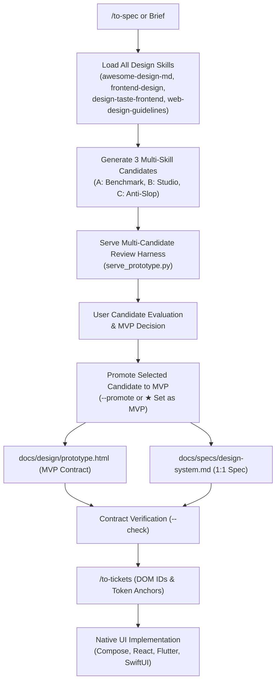

# design-prototype

[](SKILL.md)
[](LICENSE)
[](#zero-dependency-runner)
[](#)

> Convert written specifications, design briefs, or design tokens into a living, code-agnostic 1:1 visual reference, interactive multi-candidate state simulation, and formal design system specification in vanilla HTML/CSS/JS.

---

## Why Design Prototype?

Bridging UX design and frontend engineering is often fraught with friction. Static mockups leave edge-case states undefined, single-style prototypes force premature aesthetic commitment, and jump-starting production code in native UI frameworks (e.g., Jetpack Compose, React, SwiftUI, Flutter) slows down visual exploration.

`design-prototype` establishes a **Multi-Skill Candidate Exploration & MVP Promotion Workflow**:
- **Multi-Skill Candidate Exploration**: Loads all relevant design skills simultaneously (`awesome-design-md`, `frontend-design`, `design-taste-frontend`, `web-design-guidelines`). If absent, automatically installs them before generating 3 distinct design candidates.
- **Candidate Prototypes Across 3 Philosophies**:
  - **Candidate A (`awesome-design-md`)**: Curated industry benchmark aesthetic mapped to the product domain (Linear, Apple, Stripe, Raycast).
  - **Candidate B (`frontend-design`)**: Distinctive studio visual identity (bespoke typography pairing, custom 4-6 color palette, and 1 intentional aesthetic signature).
  - **Candidate C (`design-taste-frontend`)**: Anti-slop modern utility design system (audit-verified density, crisp surface elevation, ergonomic components).
- **Candidate Review & MVP Promotion Harness**: Interactive candidate selector in the header toggles tokens, typography, radii, and surfaces in real-time across all screens, states, and the 4-card catalog. Users can promote their preferred candidate to the canonical MVP Contract (`[★ Set as MVP]` or `--promote <candidate>`).
- **Dual-Pane Split Workspace**: Combines an interactive mobile/device simulator with a comprehensive 4-card Living Design System Catalog.
- **Interactive State Simulation**: Test and audit `populated`, `loading`, `empty`, and `error` states deterministically across views before writing framework code.
- **Living Design System Catalog (4-Card Inspector)**: Live Color Tokens with computed swatches, WCAG 2.1 relative luminance and contrast ratio validation table, structured typography/radii/spacing token scales, and an interactive component variants inventory with one-click preview buttons.
- **1:1 Design System Specification (`docs/specs/design-system.md`)**: Automatically produces or updates the formal concept specification mapping tokens, primitives, domain patterns, and testing seams for the promoted MVP.
- **2-Tier Token Architecture**: Decouples raw visual primitives from semantic application intent across 4 manual theme palettes (`warm_dark`, `light`, `dark`, `sepia`).
- **Zero Build Dependencies**: Runs instantly anywhere a browser exists without npm, node_modules, bundlers, or external CDNs.

---

## Dual-Pane Workspace Architecture

Every prototype created with `design-prototype` implements a dual-pane split workspace delimited by rigid ASCII comment boundaries:

```
┌────────────────────────────────────────────────────────────────────────────────────────┐
│ TOP GLOBAL HEADER: Brand Title · Candidate Selector [A | B | C] · [★ Set as MVP] ·     │
│                    Theme Selector (Warm Dark, Light, Dark, Sepia)                      │
├──────────────────────────────────────────┬─────────────────────────────────────────────┤
│ LEFT: INTERACTIVE DEVICE SIMULATOR       │ RIGHT: 4-CARD DESIGN SYSTEM CATALOG         │
│                                          │                                             │
│ ┌──────────────────────────────────────┐ │ ┌─────────────────────────────────────────┐ │
│ │ Screen Jump Bar (Overview/Detail...) │ │ │ Card 1: Live Color Tokens & Swatches    │ │
│ ├──────────────────────────────────────┤ │ ├─────────────────────────────────────────┤ │
│ │ State Bar: populated|loading|empty...│ │ │ Card 2: WCAG 2.1 Contrast Inspector     │ │
│ ├──────────────────────────────────────┤ │ ├─────────────────────────────────────────┤ │
│ │ Device Shell & Status Bar            │ │ │ Card 3: Typography, Shape & Spacing     │ │
│ │ Phone Viewport (#screen-*)           │ │ ├─────────────────────────────────────────┤ │
│ │ Top App Bar + Bottom Navigation      │ │ │ Card 4: Component Inventory & Variants  │ │
│ └──────────────────────────────────────┘ │ │         (Interactive Preview → Triggers)│ │
│                                          │ └─────────────────────────────────────────┘ │
└──────────────────────────────────────────┴─────────────────────────────────────────────┘
```

### 1. Token Layer (Primitives & Semantic)
- `/* === SECTION: TOKENS: PRIMITIVES === */`: Raw palette scales, spacing tokens (`--space-xs` through `--space-2xl`), typography families, and corner radii (`--radius-xs` through `--radius-full`).
- `/* === SECTION: TOKENS: SEMANTIC === */`: Functional token aliases declared for `:root`, candidate variations (`[data-candidate="awesome|frontend|taste"]`), and theme selectors (`[data-theme="warm_dark|light|dark|sepia"]`).

### 2. Base & Reset Layer
- `/* === SECTION: BASE & RESET === */`: CSS reset, typography base, global header, brand logo, candidate switcher pills, MVP button/badge, and theme switcher pills.

### 3. Declarative State Harness Layer
- `/* === SECTION: HARNESS: STATE SIMULATOR === */`: Dual-pane `.workspace` grid, device hardware container (`.device-container`), phone shell (`.phone-frame`), status bar, and pure CSS attribute state visibility (`[data-state="..."]`).

### 4. Component Layer (Foundational & Domain)
- `/* === SECTION: COMPONENTS: FOUNDATIONAL === */`: Low-level design system primitives: buttons, cards, badges, skeleton shimmer loaders, and inspector panel cards, tables, and swatches.
- `/* === SECTION: COMPONENTS: DOMAIN === */`: Composed application patterns: metric widgets, transaction data tables, state illustrations, and phone navigation bars.

### 5. Screen & Viewport Layer
- `/* === SECTION: SCREENS === */`: Standalone application views inside `#phoneViewport` (`#screen-overview`, `#screen-detail`, `#screen-settings`), each containing populated, loading, empty, and error branches.

### 6. JavaScript Logic & Harness Layer
- `/* === SECTION: JAVASCRIPT: LOGIC & HARNESS === */`: Multi-candidate dictionary (`CANDIDATES`), candidate switcher (`setCandidate`), MVP confirmation (`setAsMvp`), state manager (`setPrototypeState`), theme manager (`setAppTheme`), screen navigation (`navigateToScreen`), live color swatches renderer, WCAG 2.1 luminance/contrast math, and component preview triggers (`previewComponent`).

---

## 8-Step Multi-Skill Workflow

1. **Ingest Input & Clarify Topology**: Determine input modality (Spec, Brief, Design) and design system topology (Consolidated vs Self-Contained).
2. **Load All Design Skills (Auto-Install Absent)**: Verify all 4 design skills (`awesome-design-md`, `frontend-design`, `design-taste-frontend`, `web-design-guidelines`) are loaded. If absent, install them via `find-skills` or `npx skills add`.
3. **Generate Multi-Skill Prototype Candidates**: Author 3 distinct design candidates (A: Benchmark, B: Bespoke Studio, C: Anti-Slop Utility) within the prototype harness or `docs/design/candidates/`.
4. **Serve Multi-Candidate Review Harness**: Launch `serve_prototype.py` to enable live candidate, theme, and state switching across the device simulator and 4-card catalog.
5. **User Candidate Evaluation & MVP Decision**: Present candidate options with design rationale, typography scale, and WCAG compliance scores; facilitate user MVP selection.
6. **Promote Selected Candidate to MVP Contract**: Lock the chosen candidate as the canonical `docs/design/prototype.html` (via header button or `serve_prototype.py --promote <candidate>`) and generate `docs/specs/design-system.md`.
7. **Verify MVP Contract**: Run `serve_prototype.py --check` to guarantee visual contract compliance across themes, tokens, and states.
8. **Downstream Handoff**: Anchor engineering implementation tickets (`/to-tickets`) directly to prototype IDs and specification sections.

---

## Quickstart Guide

### 1. Initialize Prototype in a Project
Scaffold a prototype into `docs/design/`:

```bash
python3 /home/pedrogoncalves/.agents/skills/design-prototype/scripts/bootstrap.py --target-dir .
```

This creates:
- `docs/design/prototype.html`
- `docs/design/serve_prototype.py`

### 2. Verify Visual Contract
Validate that the prototype adheres to all architectural invariants and token pairs:

```bash
python3 docs/design/serve_prototype.py --check
```

Example output:
```text
=== Verifying Visual Contract for: docs/design/prototype.html ===

[PASS] File check: prototype.html exists (69410 bytes)
[PASS] Section delimitation: All 8 rigid markers verified
[INFO] Detected theme blocks: warm_dark, light, dark, sepia
[PASS] Themes verified: warm_dark, light, dark, sepia
[PASS] Semantic token pairs verified across themes (--bg, --surface, --on-surface, --primary)
[PASS] Declarative State Harness: All states verified (populated, loading, empty, error)

[VERDICT: PASSED] Prototype visual contract is 100% compliant.
```

### 3. List & Promote Candidates
List available candidates:

```bash
python3 docs/design/serve_prototype.py --candidates
```

Promote a candidate to the canonical MVP Contract:

```bash
python3 docs/design/serve_prototype.py --promote frontend
```

### 4. Serve & Interact
Launch the zero-dependency local HTTP server with automatic port discovery and no-cache headers:

```bash
python3 docs/design/serve_prototype.py --open
```

CLI options:
- `--candidates`: Lists available candidate prototypes in the design directory.
- `--promote <candidate>`: Promotes candidate to canonical `docs/design/prototype.html`.
- `--port <int>`: Preferred port (default `8765`).
- `--strict-port`: Disables fallback probing if the port is in use.
- `--dir <path>`: Explicit directory path.
- `--check`: Runs contract verification suite and exits with code 0/1.

---

## Agent Workflow Integration

`design-prototype` bridges written specifications with multi-skill candidate exploration, MVP promotion, and downstream engineering tickets:



---

## License

MIT License. See [LICENSE](LICENSE) for details.
