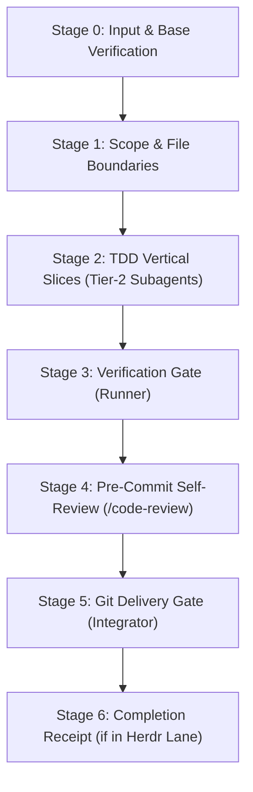

# Single-Scope Implementation Skill

Implement bounded engineering work for a single scope—such as an engineering specification, a ticket, or a Herdr Kickoff Brief.

> [!NOTE]
> Multi-worktree, parallel initiatives across isolated Git worktrees are managed by `herdr-orchestration`. The `/implement` workflow is dedicated strictly to single-scope execution within the current workspace or assigned Herdr Lane.

---

## Workflow Overview

Execution proceeds through six mandatory stages:



---

## Stage 0: Input Ingestion & Base Branch Verification

1. **Resolve Input Target**:
   - **Ticket or Spec**: Read the designated specification or ticket (e.g. `docs/tickets/...` or `docs/specs/...`).
   - **Kickoff Brief**: If passed a Kickoff Brief path (e.g. `/tmp/handoff-<session>-<lane>.md`), read the brief to extract session ID, lane name, file boundaries, dependencies, and Stage 1 test criteria.
2. **Verify Base Branch & Clean State**:
   - Verify that the working tree is clean (`git status --porcelain` is empty).
   - Verify the current branch is rooted on the intended base branch:
     ```bash
     git rev-parse --abbrev-ref HEAD
     ```
   - In a Herdr Lane, ensure the current branch matches the assigned branch specified in the Kickoff Brief (e.g., `lane/<topic>-<lane>`).
3. **Inspect Upstream Contracts**:
   - If upstream dependencies are declared, verify that prerequisite contracts or predecessor receipts (e.g. `/tmp/handoff-<session>-<dep>-result.md`) exist and are satisfied.

---

## Stage 1: Scope & File Boundaries

1. **Define Bounded Responsibility**:
   - Pinpoint the exact behaviors, APIs, or bug fixes required.
   - Do not touch unrelated code. Report unrelated defects separately.
2. **Establish Strict File Boundaries**:
   - Enforce the allowed paths designated in the ticket or Kickoff Brief.
   - All additions, modifications, and deletions must remain strictly within assigned paths.

---

## Stage 2: TDD Vertical Slices & Tier-2 Specialist Subagents

Implement the work in incremental, test-driven vertical slices following `GEMINI.md` Tier-2 Specialist Subagent delegation rules:

1. **Role Boundary — Orchestrator Does Not Edit Code**:
   - The session orchestrator directs research, strategy, planning, and delegation.
   - All code, test, and configuration modifications MUST be delegated to specialist subagents.
2. **Vertical Slice Loop**:
   For each discrete vertical slice (unit of behavior or interface contract):
   - **RED Phase**: Delegate creation of failing tests to `fixer` (or `craftsman` for complex state logic).
   - **GREEN Phase**: Delegate minimal implementation diffs to `fixer`.
   - **REFACTOR Phase**: Simplify and clean code while maintaining tests green.
3. **Subagent Delegation Protocol**:
   - Bounded diffs and fixes: Delegate to `fixer` (Tier: `gemini-3.8-flash-medium`).
   - Complex refactoring or advanced state logic: Delegate to `craftsman` (Tier: `gemini-3.8-flash-high`).
   - Each delegation must specify the exact file boundaries and objective.

---

## Stage 3: Verification Gate & Escalation Protocol

Every change must pass through deterministic verification:

1. **Read-Only Verification Gate (`runner`)**:
   - Delegate test and build execution to the `runner` subagent (Tier: `gemini-3.8-flash-low`).
   - Run typechecking, targeted unit tests regularly during slicing, and the full scope test suite before completion.
   - The gate requires a deterministic verdict: `runner` must report `VERDICT: PASSED`.
2. **Two-Attempt Remediation Limit**:
   - If `runner` reports `VERDICT: FAILED`, provide the failure diagnostics to `fixer` for Attempt 1.
   - If Attempt 2 also fails verification, halt direct fix attempts.
3. **Escalation Protocol**:
   - Delegate failure logs, diff history, and unresolved issues to `evaluator` (Tier: `gemini-3.8-flash-high`).
   - If `evaluator` issues `DECISION: RESOLVED`, route remediation instructions back to `fixer` (or `craftsman`).
   - If `evaluator` issues `DECISION: ESCALATE`, escalate to `oracle` (Tier: `gemini-4-argon-high`) for architectural root-cause analysis before applying the fix.

---

## Stage 4: Pre-Commit Self-Review (`/code-review`)

Before committing changes, execute a pre-commit review using `/code-review` principles across three parallel axes:

1. **Standards**: Verify adherence to repository coding standards, project structure, naming conventions, and linting rules.
2. **Spec**: Verify exact adherence to requirements and acceptance criteria in the originating spec, ticket, or Kickoff Brief. Confirm that no out-of-scope files were touched.
3. **Complexity**: Check time/space complexity, unnecessary abstractions, and redundant code. Simplify where possible without changing behavior.

---

## Stage 5: Git Delivery Gate (`integrator`)

1. **Delegate Delivery to `integrator`**:
   - Git operations (staging, branching, committing) must be delegated to the `integrator` subagent (Tier: `gemini-3.8-flash-medium`).
2. **Scoped Staging & Commit**:
   - Scope staging strictly to files within the assigned file boundaries.
   - Never use blanket `git add .` or commit untracked foreign artifacts.
   - Create conventional commit messages detailing the implemented scope (e.g. `feat(scope): concise summary`).

---

## Stage 6: Herdr Completion Receipt (When in a Lane)

If the implementation was triggered by a Herdr Kickoff Brief (`/tmp/handoff-<session>-<lane>.md`), write the final Completion Receipt to:
`/tmp/handoff-<session>-<lane>-result.md`

Adhere strictly to the required schema:

```markdown
# Lane Completion Receipt: <lane>

- **Session**: <session-id>
- **Lane**: <lane>
- **Topic**: <topic>
- **VERDICT**: PASSED
- **WORKFLOW**: /implement
- **COMMITS**:
  - <commit-sha> <commit-message>
- **FILES_MODIFIED**:
  - <path/to/modified/file>
- **STAGE_1_VERIFICATION**:
  - Command: `<test-command>`
  - Result: `<summary-of-results>`
- **EXPORTED_CONTRACTS**:
  - <exported-interfaces-types-or-apis>
```

> [!IMPORTANT]
> The receipt MUST include `WORKFLOW: /implement` and `VERDICT: PASSED`. The `herdr-orchestration` verification gate rejects any implementation lane completion receipt missing this declaration.
