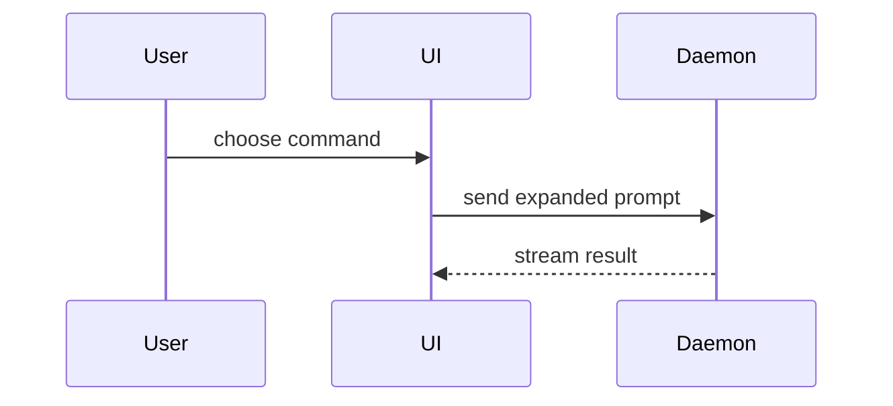

# Code Review & Evidence Submission (`pr`)

Real production engineering environments decouple **code review hosting** (Gerrit, GitHub, GitLab, Bitbucket) from **project management and issue tracking** (Jira, Linear, GitHub Issues, Akashic Vault).

- **Git review platforms** (especially Gerrit or enterprise Git) require clean, self-contained, terminal-friendly commit messages that remain readable in `git log` and diff viewers for years without external web rendering dependencies.
- **Project trackers** (such as Jira or Linear) demand rich verification evidence: before/after test logs, QA acceptance criteria verification, visual assets (screenshots/recordings), risk profiles, and cross-functional sign-off checklists.

The `pr` skill coordinates this boundary by decoupling your submission into two distinct, synchronised deliverables:
1. **Package A: Review Submission Body** — tailored for the code review host (Gerrit commit message, GitHub PR, GitLab MR, or Vault commit).
2. **Package B: Verification Evidence Package** — tailored for the issue tracker (Jira issue comment, Linear update, or Vault ticket update).

---

## 1. Agent Collaboration & Workflow Spine

The review process collaborates across three specialist agent roles:

```text
┌─────────────────┐       ┌─────────────────┐       ┌─────────────────┐
│     runner      │ ───►  │       pr        │ ───►  │   integrator    │
│                 │       │                 │       │                 │
│ executes tests, │       │ formats Package │       │ amends commit,  │
│ captures logs & │       │ A (review) and  │       │ pushes change,  │
│ visual evidence │       │ Package B (Jira)│       │ posts comments  │
└─────────────────┘       └─────────────────┘       └─────────────────┘
```

1. **`runner`**: Executes verification commands, Stage 1 tests, or visual captures, returning evidence with `VERDICT: PASSED`.
2. **`pr`**: Analyzes the diff, test evidence, and issue references. Formats Package A and Package B according to the configured review and tracker adapters.
3. **`integrator`**: Applies the formatted commit message (`git commit --amend`), preserves the Gerrit `Change-Id`, pushes to the review remote (`git review` or `git push`), and posts the evidence package to the issue tracker.

---

## 2. Configuration & Adapter Discovery

The workflow resolves adapters via `config/akashic.toml`. If unconfigured, it uses deterministic environment heuristics.

### Configuration (`config/akashic.toml`)

```toml
[workflow.review]
adapter = "gerrit"        # "gerrit" | "github" | "gitlab" | "bitbucket" | "vault"
remote = "origin"         # default review remote
base_branch = "main"      # target branch (e.g., "main", "master")

[workflow.tracker]
adapter = "jira"          # "jira" | "linear" | "github" | "gitlab" | "vault"
project_key = "PROJ"      # project prefix for ticket extraction
tickets_dir = "docs/tickets"
```

### Automatic Heuristic Detection

When `config/akashic.toml` is absent or unconfigured, inspect the workspace:

| Adapter | Review Heuristics | Tracker Heuristics |
|---|---|---|
| **Gerrit** | `.gitreview` exists; `.git/hooks/commit-msg` generates `Change-Id`; remote URL contains `gerrit` or port `:29418` | N/A |
| **GitHub** | Git remote contains `github.com`; `gh auth status` succeeds | Ticket references match `#123` or GitHub issue URLs |
| **GitLab** | Git remote contains `gitlab`; `.gitlab-ci.yml` exists; `glab auth status` succeeds | Ticket references match GitLab issue syntax |
| **Jira** | N/A | Branch name or commit contains Jira key pattern (e.g., `PROJ-[0-9]+`) |
| **Linear** | N/A | Branch name contains Linear team identifiers (e.g., `ENG-[0-9]+`) |
| **Vault** | No external review remote; local OKF v0.2 `docs/` repository | `docs/tickets/` directory exists |

---

## 3. Package A: Review Submission Body

Package A provides the formal description for the code change. Match the output format to the review host adapter:

### 3.1 Gerrit (`adapter = "gerrit"`)

Gerrit reviews are driven entirely by the **Git commit message**. Gerrit enforces strict plain-text conventions readable in standard terminals (`git log`) and the Gerrit web UI:

- **Subject Line**:
  - Imperative mood ("Add", "Fix", "Refactor", never "Added" or "Fixes").
  - Scope prefix: `<subsystem>: <imperative summary>`.
  - Max 50–72 characters. No trailing period.
- **Blank line**.
- **Motivation / Problem Statement**: Why was this change needed? What was broken or missing?
- **Solution & Architecture**: How does this change resolve the problem? Include plain-text diff-sketches or ASCII trees.
- **Merge Danger & Safety**: Operational risk, one-way vs. two-way door, blast radius.
- **Footers**:
  - `Bug: <KEY>` (or `Issue: <KEY>`, `Fixes: <KEY>`).
  - `Change-Id: I<hash>` (mandatory; preserved or generated by the Gerrit `commit-msg` hook).

#### Gerrit Commit Message Example

```text
auth: support token refresh retry on transient network failures

Transient connection resets during OAuth token refresh currently fail
immediately, forcing user re-authentication on brief mobile network drops.

Introduce an exponential backoff retry loop in TokenClient. Retries up to
three times for HTTP 503 and network socket errors before failing permanently.

Call tree:
TokenClient.refreshToken()
  executeWithRetry()
    backoffDelay()
    postTokenEndpoint()

Merge Danger:
Door: two-way (safe to roll back; token expiry fallback unchanged)
Blast Radius: auth session renewal

Bug: PROJ-4821
Change-Id: I9a8c7b6d5e4f3a2b1c0d9e8f7a6b5c4d3e2f1a0b
```

#### Gerrit Delivery Commands

```bash
# Via git-review tool:
git review -t "PROJ-4821-token-refresh"

# Or standard Git push to Gerrit review refs:
git push origin HEAD:refs/for/main%topic=PROJ-4821-token-refresh
```

---

### 3.2 GitHub (`adapter = "github"`)

GitHub PRs support markdown formatting and separate the PR title from the body:

- **PR Title**: `<type>(<scope>): <summary>` or `<subsystem>: <summary>`.
- **Markdown Body**:

```markdown
## Summary

<diagram, diff-sketch, or tree>

## Merge Danger

**Door:** <one-way or two-way>
**Blast Radius:** <subsystem or user impact>

Closes #4821
```

#### GitHub Delivery Command

```bash
gh pr create --title "auth: retry token refresh on transient network failures" --body-file pr-body.md
```

---

### 3.3 GitLab (`adapter = "gitlab"`)

GitLab Merge Requests use markdown descriptions and MR options:

```bash
glab mr create \
  --title "auth: retry token refresh on transient network failures" \
  --description "$MR_BODY" \
  --target-branch main
```

---

### 3.4 Vault / Local (`adapter = "vault"`)

For local-only development or repos without a hosted Git review platform:
- Formats a conventional commit message.
- Emits a completion handoff document (`/tmp/handoff-<session>-<topic>-result.md`).
- Updates the ticket state in `docs/tickets/<topic>/<NN>-<slug>.md`.

---

## 4. Package B: Verification Evidence Package

Package B records concrete validation proof for QA engineers, product managers, and release managers in the issue tracker.

### 4.1 Jira (`adapter = "jira"`)

Jira supports both Jira Wiki Markup and Jira Markdown depending on the organization's Jira Cloud or Server configuration.

#### Jira Evidence Package Template (Wiki Markup)

```text
h2. Verification Evidence

*Review Change:* [Change 14829|https://gerrit.internal.net/c/core/+/14829] (Commit {{9a8c7b6}})

h3. Automated Test Execution
{code:bash}
$ ./gradlew test --tests "com.example.auth.TokenClientTest"

com.example.auth.TokenClientTest > testRefreshTokenRetriesOn503 PASSED (142ms)
com.example.auth.TokenClientTest > testRefreshTokenFailsAfterMaxRetries PASSED (310ms)
2 tests completed, 0 failed, 0 skipped
{code}

h3. Visual / Execution Evidence
- *Before:* Socket timeout triggers immediate logout redirect (`TokenExpiredException`).
- *After:* Transient timeout retries smoothly; session persists without user disruption.

h3. Risk & Blast Radius
- *Door:* Two-way door. Rollback requires no database schema or persistent state migrations.
- *Blast Radius:* Mobile auth renewal lifecycle.
```

#### Jira Delivery
Post via Jira CLI (`jira issue comment add PROJ-4821 -b "..."`), Jira REST API, or web UI.

---

### 4.2 Linear (`adapter = "linear"`)

Format using standard Markdown for Linear issue comments:
- Includes direct link to Gerrit change or GitHub PR.
- Attaches test run logs, video/screenshot attachments, and verification status.

---

### 4.3 Vault (`adapter = "vault"`)

Append the verification evidence directly into the active ticket in `docs/tickets/<topic>/<NN>-<slug>.md` under `## Verification Evidence`:

```markdown
## Verification Evidence

- **Command**: `pytest tests/auth/test_token_client.py`
- **Output**: `12 passed in 0.45s`
- **Before/After**: Confirmed retry logic activates on transient 503 response.
- **Verification Gate**: `VERDICT: PASSED` (runner verification receipt verified).
```

---

## 5. Visual & Structural Change Representations

Pick the smallest view that makes the key change obvious. 

> [!IMPORTANT]
> **Plain Text vs Markdown Compatibility**:
> - **Gerrit commit messages**: Must use raw ASCII/monospace text (pseudocode, ASCII trees, text diffs). Do **not** use Markdown formatting (e.g. ` ``` `, `**bold**`, Mermaid diagrams) in Gerrit commit messages as they are displayed as raw text in Git history.
> - **GitHub / GitLab / Jira / Vault**: Markdown and Mermaid diagrams render natively.

### 5.1 Pseudocode (Logic or Algorithm Changes)

```text
on(save)
  if content is unchanged
    return cached result
  write new content
  return fresh result
```

### 5.2 Call Tree (Runtime Control Flow)

```text
submitForm
  createSession
    persistPrompt
    launchAgent
  navigateToSession
```

### 5.3 Component Tree (UI Boundaries & State)

```text
<SessionPage> (apps/example/src/routes/session.tsx)
  useSessionEvents()
  <SessionToolbar>
    <RunSkillButton> (packages/ui)
```

### 5.4 Shallow File Tree (File Responsibilities & Layouts)

```text
src/
├── commands/       # parses user actions
├── sessions/       # owns session state
└── transport/      # sends API requests
```

### 5.5 Diff Sketches (Targeted Changes in Pre-existing Structures)

For a component change:
```diff
 <SessionPage>
   useSessionEvents()
   <SessionToolbar>
+    <RunSkillButton />
   <SessionTimeline>
+    <SkillResultCard />
```

For a file-layout change:
```diff
 src/
 ├── commands/
+│   └── show-me.ts       # expands the slash command
 ├── sessions/
-└── transport.ts
+└── transport/
+    ├── client.ts
+    └── stream.ts
```

For a call-tree change:
```diff
 submitForm
   createSession
     persistPrompt
+    expandSkillMention
     launchAgent
-  navigateToSession
+  navigateToSession
+    subscribeToEvents
```

For a state or control-flow change:
```diff
 on(save)
-  write content
+  if content is unchanged
+    return cached result
+  write new content
+  invalidate cache
```

### 5.6 Mermaid Diagrams (Rendered Markdown Platforms)

Use only for platforms supporting markdown rendering (GitHub, GitLab, Vault, Jira Markdown):



---

## 6. Merge Danger & Blast Radius Assessment

Every review submission must explicitly evaluate risk:

- **Door Type**:
  - **Two-way door**: The change is easily reversible. Rolling back code restores prior behavior cleanly without data corruption, migration undo, or consumer protocol breaks.
  - **One-way door**: The change cannot be reversed cleanly (e.g. destructive database schema changes, irreversible data migration, public contract breaking changes). Requires elevated scrutiny and explicit rollback strategy.
- **Blast Radius**:
  - The direct and adjacent modules, user flows, and third-party integrations touched or potentially affected by this change. Identify potential side effects (e.g., layout shifts, cache invalidation storms, latency impacts).
